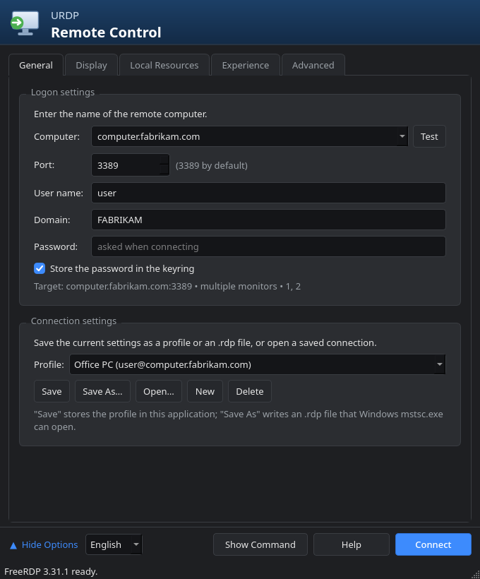
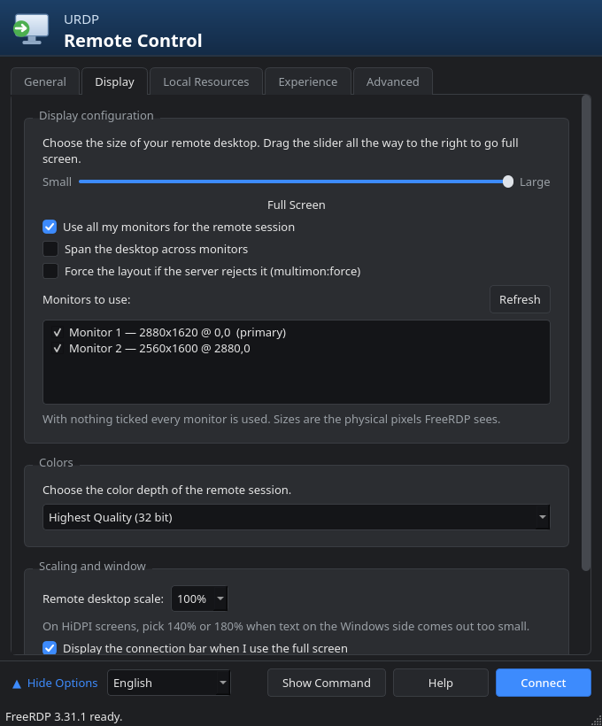
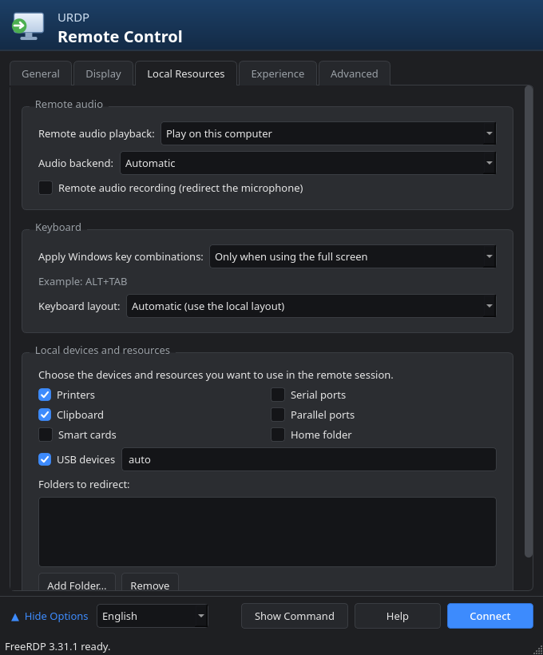
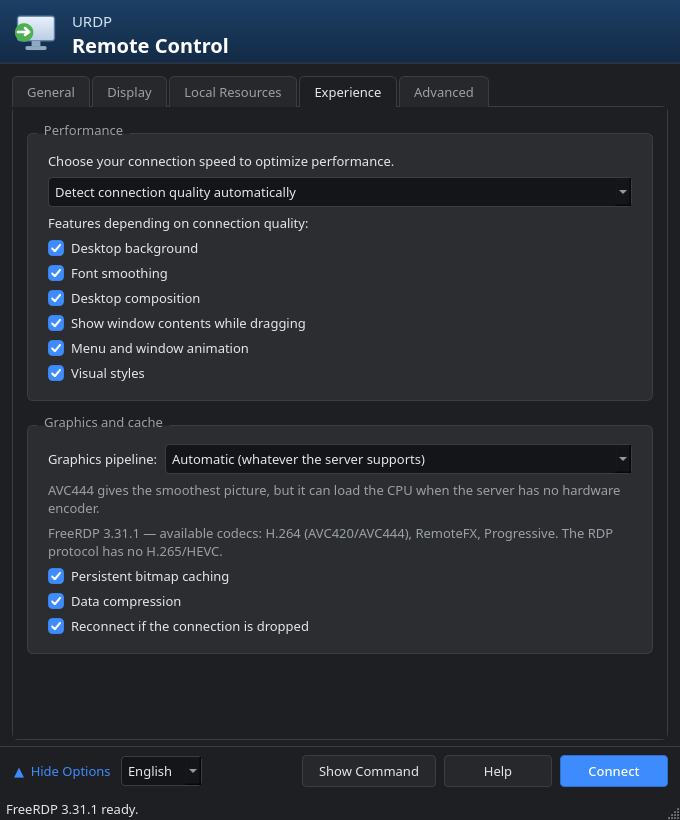
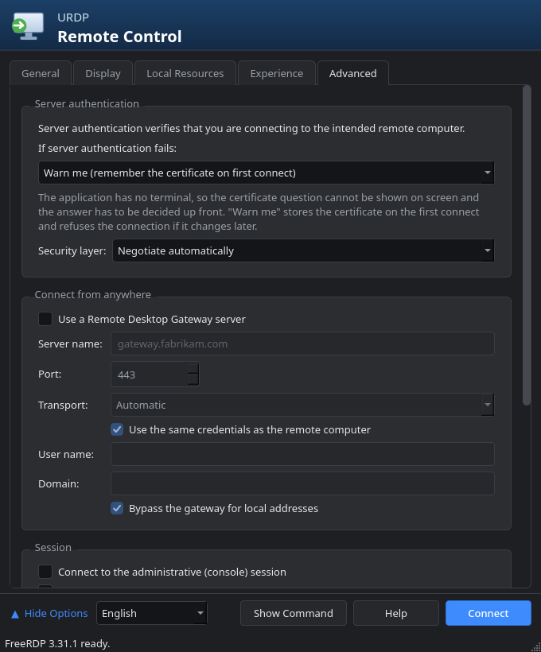
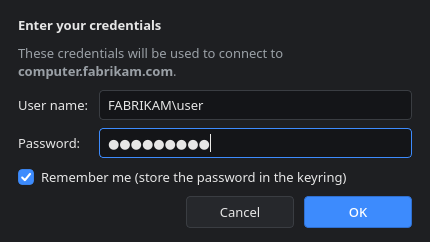
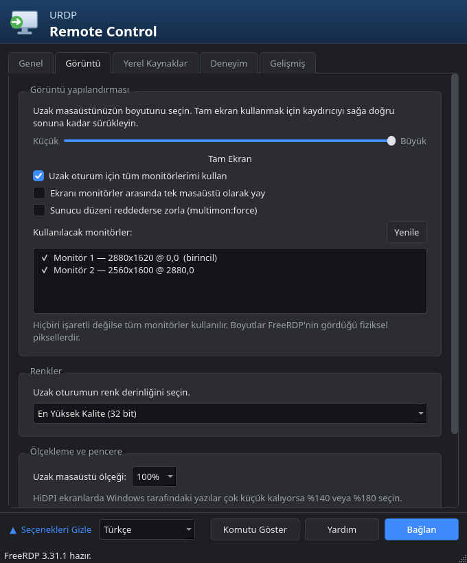

# URDP Remote Control

A Linux front-end for Windows Remote Desktop, laid out like `mstsc.exe` — the
same five tabs, the same options, a dark theme. FreeRDP does the actual work.

The reason it exists is **multi-monitor**: mstsc's "Use all my monitors for the
remote session" is here too, and you can pick which monitors to hand over.
Windows genuinely sees two monitors — taskbar on both, maximize fills one
screen, `Win+Shift+Arrow` moves a window across.

🇹🇷 [Türkçe README](README.tr.md)

## Screenshots

| General | Display |
|---|---|
|  |  |

| Local Resources | Experience | Advanced |
|---|---|---|
|  |  |  |



## Requirements

This program does not speak RDP itself — **it is a front-end that runs
FreeRDP.** Without FreeRDP it can do nothing, so that is the first requirement.

| Package | Why | Required |
|---|---|---|
| **FreeRDP 3** (`xfreerdp3`) | Makes the actual connection | **Yes** |
| **PyQt6** | The interface | **Yes** |
| `libsecret` (`secret-tool`) | Stores passwords in KDE Wallet / GNOME Keyring | No, but password saving needs it |
| `krfb` (`krfb-virtualmonitor`) | Tablet screen (KDE Plasma Wayland only) | No |

FreeRDP **3** is required. FreeRDP 2 spells many options differently
(`/cert-tofu`, `/monitor-list`); if an older version is found, the application
says so in the status bar.

```bash
# Arch / CachyOS / Manjaro
sudo pacman -S freerdp python-pyqt6 libsecret

# Debian 13+ / Ubuntu 24.04+
sudo apt install freerdp3-x11 python3-pyqt6 libsecret-tools

# Fedora
sudo dnf install freerdp python3-pyqt6 libsecret

# openSUSE
sudo zypper install freerdp3 python313-PyQt6 libsecret-tools
```

Check it landed:

```bash
xfreerdp3 /version
```

It must print `3.x`. If it does not, your distribution has no FreeRDP 3 package
— that is the case on older Debian/Ubuntu releases. The Flatpak build
(`flatpak install flathub com.freerdp.FreeRDP`) works, but then you need a
wrapper named `xfreerdp3` somewhere on your `PATH`.

If FreeRDP 3 is missing when the application starts, it names the packages for
your distribution (Arch, Debian/Ubuntu, Fedora, openSUSE families) and offers to
install them. **Install** runs the package manager through `pkexec`, which asks
for your password itself; nothing is installed without that click.

## Install

### AppImage

Download `URDP-Remote-Control-x86_64.AppImage` from the
[Releases](https://github.com/666subaru/urdp-remote-control/releases) page, then:

```bash
chmod +x URDP-Remote-Control-x86_64.AppImage
./URDP-Remote-Control-x86_64.AppImage
```

It carries Python, PyQt6 and the file-copy fix, so no compiler is needed.
FreeRDP is **not** inside: it handles everything a remote server sends and gets
security updates often, so it stays a system package that your distribution
keeps patched. If it is missing, the application offers to install it (see
above).

### From the repository

From inside the repository:

```bash
./install.sh
```

That creates a `~/.local/bin/urdp` symlink and an application-menu entry. No
root, nothing written outside `$HOME`. To uninstall, delete those two files.

To try it without installing:

```bash
./bin/urdp
```

## Use

1. On the **General** tab, enter the computer name and user name.
2. On the **Display** tab, tick "Use all my monitors for the remote session".
3. **Connect**.

`Ctrl+Alt+Enter` leaves full screen.

### Languages

37 languages, matching the display languages Windows itself ships:

`en` English · `da` Dansk · `de` Deutsch · `et` Eesti · `es` Español · `fr` Français · `hr` Hrvatski · `id` Indonesia · `it` Italiano · `lv` Latviešu · `lt` Lietuvių · `hu` Magyar · `nl` Nederlands · `nb` Norsk bokmål · `pl` Polski · `pt` Português · `pt_BR` Português (Brasil) · `ro` Română · `sk` Slovenčina · `sl` Slovenščina · `sr` Srpski · `fi` Suomi · `sv` Svenska · `vi` Tiếng Việt · `tr` Türkçe · `cs` Čeština · `el` Ελληνικά · `bg` Български · `ru` Русский · `uk` Українська · `he` עברית · `ar` العربية · `th` ไทย · `ja` 日本語 · `zh_CN` 简体中文 · `zh_TW` 繁體中文 · `ko` 한국어

The picker sits in the bottom-left corner; the choice is remembered. On first
run the language is taken from your environment (`LANG`), and a locale with a
region (`pt_BR`, `zh_CN`) wins over the bare language when both exist. Arabic
and Hebrew mirror the whole interface, not just the text.



> **Translations are machine-generated and have not been reviewed by native
> speakers.** Corrections are very welcome — open an issue or a pull request.
> A wrong word costs one line in one JSON file.

Adding a language is a single file: copy the key set from `keys.json`, translate
the values, save it as `urdp/locale/<code>.json`. No code changes, no build step.
`python3 -m unittest discover -s tests` then checks that your file matches the
strings in the source and that every `{placeholder}` survived.

### The tabs

| Tab | Contents |
|---|---|
| **General** | Address, port, user, domain, password, profile save/open |
| **Display** | Resolution slider, multi-monitor, monitor picker, colour depth, 100/140/180% scaling, connection bar |
| **Local Resources** | Audio direction and backend, microphone, keyboard hook and layout, printers, clipboard, smart cards, serial/parallel ports, USB, folder redirection |
| **Experience** | Connection-speed preset and its six visual effects, graphics pipeline (AVC444/AVC420/RFX), caching, compression, auto-reconnect |
| **Advanced** | Certificate policy, security layer (NLA/TLS/RDP), RD Gateway, admin/restricted-admin session, RemoteApp, timeout, extra FreeRDP options |

### Compared with mstsc

Every option from mstsc's five tabs has a counterpart. On top of that:

- Pick individual monitors (`/monitors:`)
- Choose the FreeRDP graphics codec, and see which codecs the installed FreeRDP
  build actually supports
- HiDPI scaling
- As many redirected folders as you like
- **Show Command** prints the generated `xfreerdp3` command line, ready to paste
  into a script
- **Test** resolves the address and probes port 3389 before you connect

The one thing with no counterpart is mstsc's "Use a web account to sign in to
the remote computer"; FreeRDP's Entra ID flow works differently.

## Tablet screen — a tablet or phone as an extra monitor

On KDE Plasma (Wayland), **Tablet Screen** in the bottom bar turns a tablet or
phone on the same network into another monitor of this computer — windows
move onto it like onto any screen, and touch and pen work as the mouse. The
tablet needs only its browser: scan the QR code with its camera, or open the
address and type the code.

How it works: `krfb-virtualmonitor` (from the `krfb` package) asks KWin for a
virtual screen and streams it over VNC on a random local port. URDP serves a
page built on [noVNC](https://github.com/novnc/noVNC) and bridges the page's
WebSocket to that VNC server, so only **one port** (default 1701) has to be
reachable from the network.

- **Size.** "Match the tablet (sharp)" sizes the screen to the tablet's real
  pixels and scales it like the tablet does (a 2960 × 1848 tablet becomes a
  1480 × 924 screen at 2×); "lighter" skips the scaling and sends a quarter of the pixels on such a tablet. Rotating
  the tablet re-sizes the screen.
- **Position.** Right, left, above or below the existing screens.
- **Touch and pen.** When `/dev/uinput` is writable (logind grants it to the
  desktop user on most systems), URDP creates a virtual touchscreen and pen
  and ties both to the tablet screen, so KDE gets real touch (scrolling,
  press-and-hold) and a real pen with pressure, tilt, hover and eraser.
  A physical keyboard on the tablet types with the computer's own layout;
  the ⌨ button opens the on-screen keyboard, whose text is typed key by
  key using that layout (xkbcommon).
  `krfb-virtualmonitor` itself drops VNC input, so without uinput the tablet
  is view-only.
- **Screen stays on.** The page plays a tiny silent video behind the picture,
  which keeps Android from dimming the tablet (the Wake Lock API needs HTTPS).
- **Access.** Everything but the noVNC files needs the code, which travels in
  the URL fragment (never sent to the server or in a Referer) and is then
  kept in the tablet browser. After 20 wrong codes access is blocked until
  sharing is started again. **New Code** disconnects everyone. The connection
  is plain HTTP, meant for a home or office network.
- **Firewall.** If one is active, allow the port from the local network, for
  example `sudo ufw allow from 192.168.1.0/24 to any port 1701 proto tcp`.
- **VPNs.** A VPN that takes over the local network's route (for example
  Tailscale accepting a subnet route of your own LAN) sends the answers to
  the tablet into the tunnel; the window warns when it detects this.

## Codecs — is there H.265?

No. The RDP protocol defines no H.265/HEVC codec; the ceiling is H.264
(AVC444). Full evidence, and where the "but my system uses H.265" impression
comes from: [docs/codecs.md](docs/codecs.md).

At startup the application reads `xfreerdp3 /buildconfig` and shows, on the
Experience tab, which codecs the installed FreeRDP really supports; codecs that
were not compiled in are greyed out. This matters, because FreeRDP's `/gfx`
parser **silently ignores** values it does not recognise — a wrong codec name
does nothing at all, without an error.

## Profiles and files

- Profiles: `~/.config/urdp/profiles.json`
- Passwords: libsecret (KDE Wallet / GNOME Keyring). They are **never** written
  to the configuration file and never passed on the command line — `/from-stdin`
  feeds them through the process' standard input, so they do not show up in
  `ps`. The credential prompt's "Remember me" box can start saving one;
  clearing it deletes the stored password.
- **Save As** writes a real `.rdp` file that `mstsc.exe` can open on Windows,
  and **Open** reads the `.rdp` files mstsc writes.

## When a connection fails

FreeRDP reports a single error for every unreachable host:
`ERRCONNECT_CONNECT_FAILED`. A wrong name, a sleeping machine and a broken VPN
route all produce that same line. The application then probes the host itself
and says which one it is:

- the name does not resolve,
- the address answers but the port is closed (Remote Desktop is off),
- or nothing answers at all (machine asleep, firewall, or the route to that
  address is broken).

The **Test** button on the General tab runs the same probe before you connect.

## Known limits

- **Copying screenshots from Windows.** FreeRDP 3.31 cannot turn a Windows
  `CF_DIB` with `BI_BITFIELDS` compression — the layout Windows uses for
  screenshots — into PNG, so Linux applications (which ask for PNG first) paste
  nothing. The same image does arrive intact as BMP. While a session runs, a
  small helper (`urdp/clipfix.py`) spots a clipboard whose PNG is unreadable but
  whose BMP is fine, converts it with Qt and puts a proper image back. It never
  touches a clipboard whose PNG already works.

- **Copying files from Windows.** FreeRDP 3.32 exposes the copied files under
  `/tmp/com.freerdp.client.cliprdr.<pid>/` but cannot turn Windows' file list
  into `text/uri-list` (its converter is handed the wrong format id), so a file
  manager pastes nothing. `urdp/native/filelist.c`, preloaded into `xfreerdp3`,
  builds that list itself whenever FreeRDP returns none. It is compiled once
  with the system C compiler (`cc`) and cached in `~/.cache/urdp/`; without a
  compiler the session still runs, only without this fix. FreeRDP 3.33 fixed
  the conversion itself, and the library then stays out of the way.

- **Copying large files to Windows.** `xfreerdp3` drops its list of local files
  whenever the X selection is announced again, which a Wayland desktop does when
  the session window loses focus, even though nothing new was copied. Windows
  then fails mid-copy with "unspecified error". The same preloaded library keeps
  the list unless the server itself announces new clipboard content. Copying
  something else on Windows during a transfer still aborts it.

- The Windows side must be a **Pro / Enterprise / Education** edition. Home has
  no RDP server.
- The certificate question cannot be shown, because the application has no
  terminal; the policy is chosen in advance on the **Advanced** tab. "Warn me"
  stores the certificate on first connect (TOFU) and refuses the connection if
  it later changes.
- Dynamic resolution and smart sizing only work for a single monitor in
  windowed mode; RDP does not support them with multiple monitors.
- On Wayland, FreeRDP's X11 client is used through XWayland. The native Wayland
  client `wlfreerdp3` is avoided because its multi-monitor support is not
  reliable.

## Development

```bash
QT_QPA_PLATFORM=offscreen python3 -m unittest discover -s tests -v
```

The tests cover the non-GUI core: command generation, `.rdp` conversion,
profile parsing, monitor-list parsing, the reachability probe, translation
integrity, and the tablet screen's sizing, layout, QR codes and web bridge.

| File | Responsibility |
|---|---|
| `profile.py` | Settings model, connection-speed presets |
| `rdpcmd.py` | `Profile` → `xfreerdp3` command line, validation |
| `rdpfile.py` | Read/write `.rdp` |
| `store.py` | `profiles.json` |
| `keyring.py` | `secret-tool` wrapper |
| `monitors.py` | Parses `xfreerdp3 /list:monitor` |
| `capabilities.py` | Codec detection via `xfreerdp3 /buildconfig` |
| `probe.py` | Name resolution + TCP probe for failure diagnosis |
| `session.py` | Process supervision and error diagnosis |
| `i18n.py`, `locale/` | Translation |
| `theme.py`, `widgets.py` | Dark theme and shared pieces |
| `tab_*.py` | The five tabs |
| `mainwindow.py` | Window, profile management, connect flow |
| `tablet.py`, `tabletdialog.py`, `web/` | Tablet screen: virtual screen, web server, page |
| `qr.py` | Small QR encoder for the tablet address |

## Licence

MIT. `urdp/web/novnc/` is an unmodified copy of noVNC 1.7.0 (`core/` and
`vendor/pako/`), under the MPL 2.0 and, for pako, MIT; see the licence files
in that folder.
