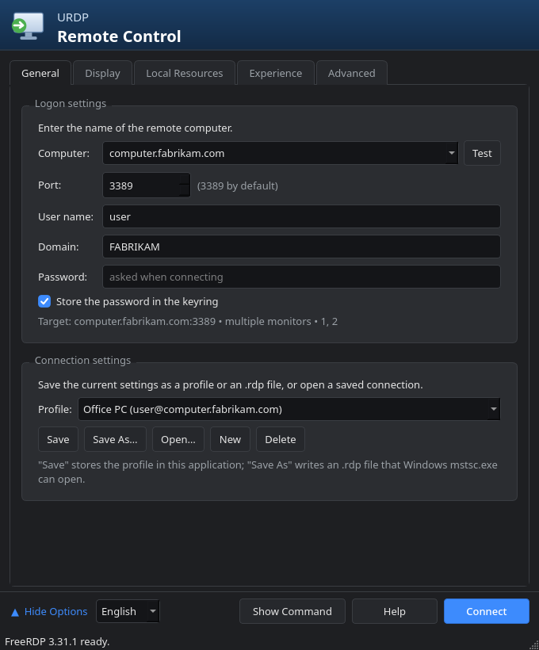
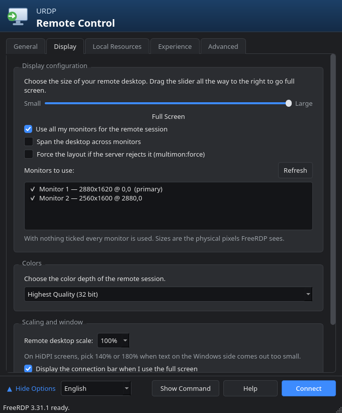
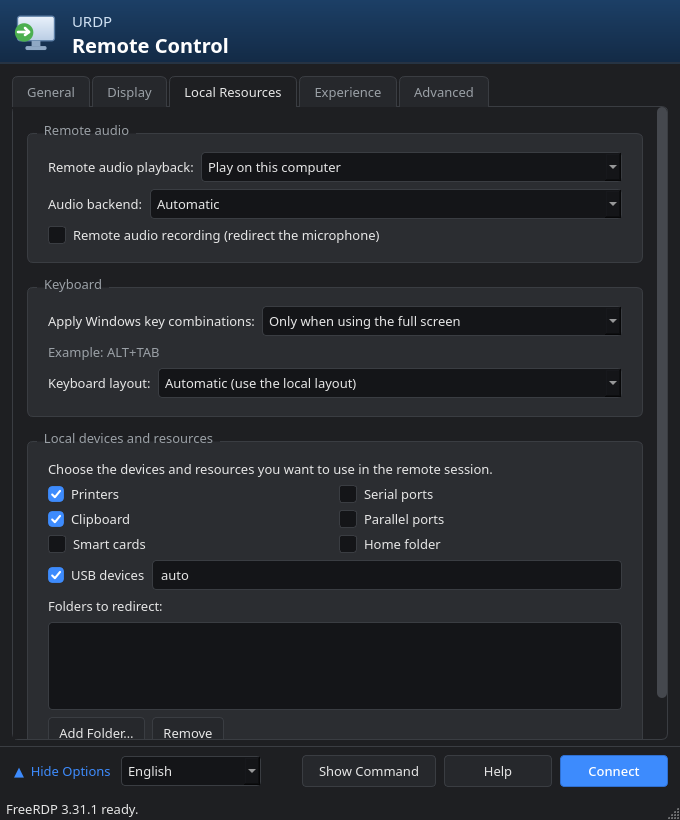
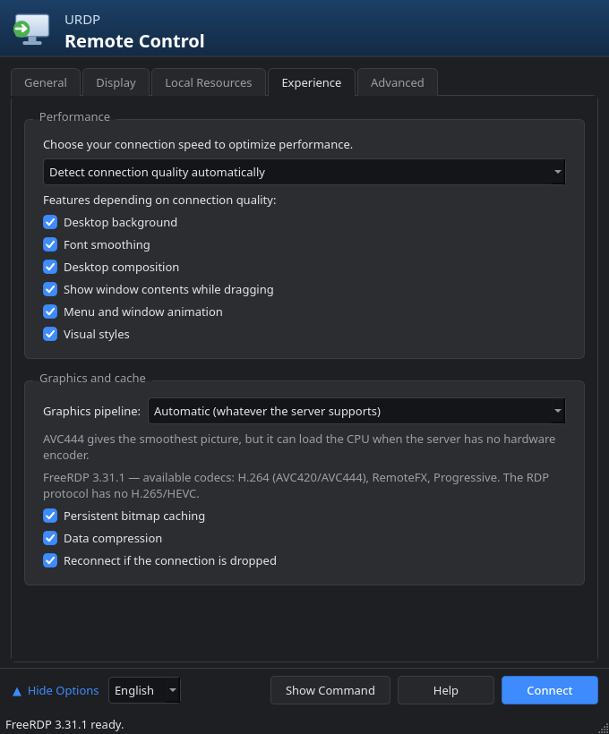
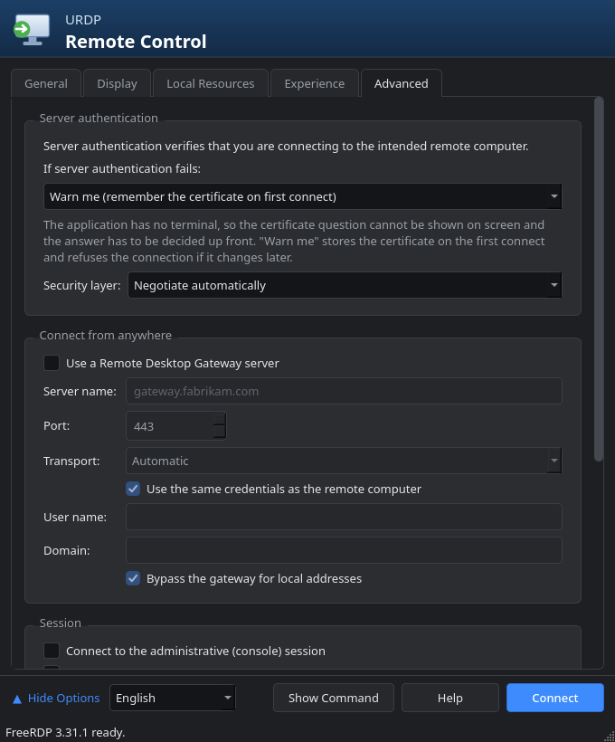
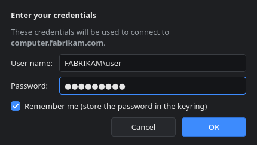

# URDP Remote Control

🇬🇧 [English README](README.md)

Windows'un `mstsc.exe` (Uzak Masaüstü Bağlantısı) penceresinin Linux karşılığı.
Aynı beş sekme, aynı seçenekler, karanlık tema — arka planda FreeRDP çalışır.

Öne çıkan yanı **çift/çoklu monitör**: mstsc'deki "Uzak oturum için tüm
monitörlerimi kullan" seçeneği burada da var, üstelik hangi monitörlerin
kullanılacağını tek tek seçebiliyorsunuz.

## Ekran görüntüleri

| Genel | Görüntü |
|---|---|
|  |  |

| Yerel Kaynaklar | Deneyim | Gelişmiş |
|---|---|---|
|  |  |  |



## Gereksinimler

Bu uygulama kendi başına RDP konuşmaz — **arka planda FreeRDP'yi çalıştıran bir
arayüzdür.** FreeRDP kurulu değilse hiçbir şey yapamaz, o yüzden ilk şart odur.

| Paket | Neden gerekli | Zorunlu mu |
|---|---|---|
| **FreeRDP 3** (`xfreerdp3`) | Bağlantıyı asıl kuran program | **Evet** |
| **PyQt6** | Arayüz | **Evet** |
| `libsecret` (`secret-tool`) | Parolayı KDE Cüzdan / GNOME Keyring'de saklamak | Hayır, ama parola kaydetme onsuz çalışmaz |
| `krfb` (`krfb-virtualmonitor`) | İkinci ekran (yalnız KDE Plasma Wayland) | Hayır |
| `pactl`, `parec` (`libpulse` / `pipewire-pulse`) | İkinci ekran sesi | Hayır |
| GStreamer (`gst-launch-1.0`, PipeWire eklentisi; VA-API eklentileri isteğe bağlı) | İkinci ekran hızlı görüntü | Hayır |
| `openssl`, `pacat` | İkinci ekran HTTPS ve mikrofon | Hayır |
| GStreamer JPEG eklentileri; `v4l2loopback` isteğe bağlı | İkinci ekran kamera | Hayır |

FreeRDP **3** gerekiyor. FreeRDP 2 birçok seçeneği farklı yazar
(`/cert-tofu`, `/monitor-list` gibi); uygulama eski bir sürüm bulursa durum
çubuğunda uyarır.

```bash
# Arch / CachyOS / Manjaro
sudo pacman -S freerdp python-pyqt6 libsecret

# Debian 13+ / Ubuntu 24.04+
sudo apt install freerdp3-x11 python3-pyqt6 libsecret-tools

# Fedora
sudo dnf install freerdp python3-pyqt6 libsecret

# openSUSE
sudo zypper install freerdp3 python313-PyQt6 libsecret-tools
```

Doğru kurulduğunu şöyle sınayabilirsiniz:

```bash
xfreerdp3 /version
```

`3.x` yazmalı. Yazmıyorsa dağıtımınızın deposunda FreeRDP 3 yok demektir;
Debian/Ubuntu'nun eski sürümlerinde durum budur, Flatpak sürümü
(`flatpak install flathub com.freerdp.FreeRDP`) iş görür ama o zaman
başlatıcının `xfreerdp3`'ü bulabilmesi için PATH'e bir sarmalayıcı koymanız
gerekir.

Uygulama açılırken FreeRDP 3 yoksa dağıtımınıza (Arch, Debian/Ubuntu, Fedora,
openSUSE aileleri) uygun paketleri gösterir ve kurmayı önerir. **Kur** düğmesi
paket yöneticisini `pkexec` ile çalıştırır, parolayı pkexec kendisi sorar; o
tıklama olmadan hiçbir şey kurulmaz.

## Kurulum

### AppImage

[Releases](https://github.com/666subaru/urdp-remote-control/releases)
sayfasından `URDP-Remote-Control-x86_64.AppImage` dosyasını indirin, sonra:

```bash
chmod +x URDP-Remote-Control-x86_64.AppImage
./URDP-Remote-Control-x86_64.AppImage
```

İçinde Python, PyQt6 ve dosya kopyalama düzeltmesi var, derleyici gerekmez.
FreeRDP **içinde değil**: uzak sunucudan gelen her şeyi o işliyor ve sık
güvenlik güncellemesi alıyor, bu yüzden dağıtımınızın güncel tuttuğu sistem
paketi olarak kalıyor. Eksikse uygulama kurmayı önerir (yukarıya bakın).

### Depodan

Depo içinden:

```bash
./install.sh
```

`~/.local/bin/urdp` sembolik bağını ve uygulama menüsü kısayolunu oluşturur.
Root gerekmez, `$HOME` dışına hiçbir şey yazmaz. Kaldırmak için iki dosyayı
silmeniz yeterli.

Kurmadan denemek isterseniz:

```bash
./bin/urdp
```

## Kullanım

1. **Genel** sekmesinde bilgisayar adını ve kullanıcı adını girin.
2. **Görüntü** sekmesinde "Uzak oturum için tüm monitörlerimi kullan"ı işaretleyin.
3. **Bağlan**.

Tam ekrandan çıkmak için `Ctrl+Alt+Enter`.

### Diller

37 dil — Windows'un kendi sunduğu görüntü dili setiyle aynı:

`en` English · `da` Dansk · `de` Deutsch · `et` Eesti · `es` Español · `fr` Français · `hr` Hrvatski · `id` Indonesia · `it` Italiano · `lv` Latviešu · `lt` Lietuvių · `hu` Magyar · `nl` Nederlands · `nb` Norsk bokmål · `pl` Polski · `pt` Português · `pt_BR` Português (Brasil) · `ro` Română · `sk` Slovenčina · `sl` Slovenščina · `sr` Srpski · `fi` Suomi · `sv` Svenska · `vi` Tiếng Việt · `tr` Türkçe · `cs` Čeština · `el` Ελληνικά · `bg` Български · `ru` Русский · `uk` Українська · `he` עברית · `ar` العربية · `th` ไทย · `ja` 日本語 · `zh_CN` 简体中文 · `zh_TW` 繁體中文 · `ko` 한국어

Seçici sol alt köşede; seçim hatırlanıyor. İlk açılışta dil ortamdan (`LANG`)
alınır; bölge kodu olan bir yerel ayar (`pt_BR`, `zh_CN`) varsa yalın dilin
önüne geçer. Arapça ve İbranice'de yalnızca metin değil, arayüzün tamamı
aynalanır.

> **Çeviriler makine üretimidir ve ana dili konuşanlarca gözden geçirilmemiştir.**
> Düzeltmeler memnuniyetle karşılanır — issue ya da pull request açın. Yanlış bir
> kelime, tek bir JSON dosyasındaki tek satırdır.

Yeni dil eklemek tek dosya: `keys.json` içindeki anahtar kümesini alın,
değerleri çevirin, `urdp/locale/<kod>.json` olarak kaydedin. Kod değişikliği ya
da derleme adımı yok. Testler dosyanızın kaynaktaki dizgelerle örtüştüğünü ve
`{yer_tutucu}` ifadelerinin korunduğunu doğrular.

### Sekmeler

| Sekme | İçerik |
|---|---|
| **Genel** | Adres, port, kullanıcı, etki alanı, parola, profil kaydetme/açma |
| **Kimlik penceresi** | Kayıtlı parola yoksa bağlanırken açılır: kullanıcı adı, parola ve Windows'taki gibi "Beni hatırla" kutusu |
| **Görüntü** | Çözünürlük kaydırıcısı, çoklu monitör, monitör seçimi, renk derinliği, %100/140/180 ölçekleme, bağlantı çubuğu |
| **Yerel Kaynaklar** | Ses yönü ve arka ucu, mikrofon, klavye kancası ve düzeni, yazıcı, pano, akıllı kart, seri/paralel port, USB, klasör yönlendirme |
| **Deneyim** | Bağlantı hızı ön ayarı ve altı görsel efekt, grafik hattı (AVC444/AVC420/RFX), önbellek, sıkıştırma, otomatik yeniden bağlanma |
| **Gelişmiş** | Sertifika politikası, güvenlik katmanı (NLA/TLS/RDP), RD Gateway, yönetici/kısıtlı yönetici oturumu, RemoteApp, zaman aşımı, ek FreeRDP parametreleri |

### mstsc ile karşılaştırma

Beş sekmedeki her mstsc seçeneğinin karşılığı vardır. Ek olarak:

- Kullanılacak monitörleri tek tek seçme (`/monitors:`)
- FreeRDP grafik hattı (codec) seçimi ve kurulu FreeRDP yapısının gerçekten
  hangi kodekleri desteklediğinin gösterilmesi
- HiDPI ölçekleme
- Klasör yönlendirmede istediğiniz kadar paylaşım
- "Komutu Göster" ile üretilen `xfreerdp3` komutunu görüp betiğe kopyalama
- **Sına** düğmesi: bağlanmadan önce adı çözer ve 3389 portunu yoklar

Karşılığı olmayan tek şey mstsc'nin "Uzak bilgisayarda oturum açmak için bir web
hesabı kullan" seçeneğidir; FreeRDP'nin Azure AD/Entra akışı farklı çalışır.

## İkinci ekran — tablet ya da telefon ek monitör olarak

KDE Plasma'da (Wayland) alt çubuktaki **İkinci Ekran**, aynı ağdaki bir tableti
ya da telefonu bu bilgisayarın bir monitörü yapar: pencereler ona her ekrana
olduğu gibi taşınır, dokunma ve kalem fare olarak çalışır. Tablette yalnızca
tarayıcı gerekir: QR kodu kamerasıyla okutun ya da adresi açıp kodu yazın.

Nasıl çalışır: `krfb-virtualmonitor` (`krfb` paketi) KWin'den sanal bir ekran
ister ve onu rastgele bir yerel portta VNC ile yayınlar. URDP,
[noVNC](https://github.com/novnc/noVNC) üzerine kurulu bir sayfa sunar ve
sayfanın WebSocket'ini bu VNC sunucusuna bağlar; böylece ağdan erişilmesi
gereken **tek bir port** vardır (varsayılan 1701).

- **Boyut.** "Tablete uydur (keskin)" ekranı tabletin gerçek piksellerine göre
  açar ve tablet gibi ölçekler (2960 × 1848 bir tablet 2× ölçekli 1480 × 924
  ekran olur); "daha hafif" ölçeklemeyi atlar, böyle bir tablette pikselin dörtte birini gönderir. Tableti
  döndürmek ekranı yeniden boyutlandırır.
- **Konum.** Mevcut ekranların sağı, solu, üstü ya da altı.
- **Dokunma ve kalem.** `/dev/uinput` yazılabiliyorsa (logind çoğu sistemde
  masaüstü kullanıcısına verir) URDP tablet ekranı için sanal giriş aygıtları
  oluşturur. **Giriş** seçeneği davranışı belirler: *fare olarak*
  (varsayılan; kalem ucu sol tık, yan tuş sağ tık, havada tutunca imleç
  gider; parmakla dokunma tıklar ve sürükler, iki parmak kaydırır ya da sağ
  tıklar) Wayland kalem desteği zayıf olan Chrome dahil her programda
  çalışır; *dokunma ve kalem olarak* KDE'ye gerçek dokunmatik ekran (kendi
  hareketleriyle) ve basınç, eğim, havada imleç ve silgi ucuyla gerçek bir
  kalem verir; çizim programları içindir. Tabletin fiziksel klavyesi bilgisayarın kendi diziliminle
  yazar; ⌨ düğmesi ekran klavyesini açar, onun metni de aynı dizilimle tuş
  tuş yazılır (xkbcommon). `krfb-virtualmonitor` VNC'den gelen girişi yok saydığı için
  uinput olmadan tablet yalnızca görüntü gösterir.
- **Görüntü.** *Hızlı* (varsayılan), sanal ekranı masaüstünün ekran
  paylaşım portalı üzerinden kaydeder: KDE bir kez hangi ekranın
  paylaşılacağını sorar (**URDP-Tablet**'i seçin; cevabı hatırlar),
  GStreamer de her kareyi JPEG'e çevirir, mümkünse VA-API ile ekran kartında.
  Tablet saniyede 60 kareye kadar, bir değişiklikten yaklaşık 20 ms sonra
  görüntü alır; yavaş ağda daha az kare alır, eski kare almaz. *Uyumlu*,
  krfb'nin kendi VNC akışını kullanır; o saniyede en fazla 10 kare ve
  saniyenin onda biri geriden gönderir. GStreamer yoksa ya da paylaşım
  reddedilirse sayfa onu kullanır.
- **Ses.** **Ses: Tablette** seçiliyken URDP bir "URDP Tablet" hoparlörü
  ekler (`pactl` ve `parec` ile PipeWire/PulseAudio boş çıkışı) ve paylaşım
  sürdükçe onu varsayılan çıkış yapar; tablet gelen sesi çalar (48 kHz
  stereo, iyi bir ağda saniyenin onda birinden az geriden). Tarayıcılar sesi ancak bir
  dokunuştan sonra başlatır. Paylaşım durunca önceki çıkış yeniden varsayılan
  olur. Bir program masaüstünün ses ayarlarından yine başka çıkışa
  yönlendirilebilir.
- **Mikrofon.** **Mikrofon: Tabletin mikrofonu** seçiliyken URDP bir "URDP
  Tablet Microphone" girişi ekler (`pacat` ile içine çalınan boş bir çıkış ve
  ondan türetilen bir kaynak) ve paylaşım sürdükçe onu varsayılan giriş
  yapar; görüşmeler ve kayıtlar tableti duyar. Tarayıcı mikrofon iznini bir
  kez sorar ve sesi önce temizler: yankı engelleme, tabletten çalan
  bilgisayar sesini mikrofondan uzak tutar. Paylaşım durunca önceki giriş
  geri gelir.
- **Kamera.** **Kamera: Tabletin ön/arka kamerası** seçiliyken sayfa o
  kameranın gördüğünü JPEG olarak gönderir (saniyede 30'a kadar), GStreamer
  da paylaşım sürdükçe bunu bu bilgisayarda 1280 × 720 bir kamera yapar:
  "URDP Tablet Camera" (dik duran tablette yanlarda siyah bant olur).
  Yüklü ve yazılabilir bir `v4l2loopback` aygıtı varsa URDP onu kullanır ve
  kamerayı her program görür. Yoksa URDP bir PipeWire kamerası yapar; onu
  PipeWire kullanan programlar görür (OBS, Firefox, KDE'nin kendi
  programları), diğerleri görmez. Modülü yüklemek için (root olarak; ikinci
  satır yeniden başlatmadan sonra da yüklenmesini sağlar):

  ```bash
  sudo modprobe v4l2loopback exclusive_caps=1 card_label="URDP Tablet Camera"
  echo v4l2loopback | sudo tee /etc/modules-load.d/v4l2loopback.conf
  echo 'options v4l2loopback exclusive_caps=1 card_label="URDP Tablet Camera"' | sudo tee /etc/modprobe.d/v4l2loopback.conf
  ```
- **HTTPS.** Tarayıcılar mikrofonu ve kamerayı yalnız HTTPS sayfalarına verir; bu yüzden
  URDP `openssl` ile kendi sertifikasını yapar (`~/.config/urdp/tablet-tls/`
  içinde saklanır) ve sayfayı HTTPS ile sunar; eski bir `http://` adresi
  oraya yönlendirilir. Yerel bir adres tarayıcının güvendiği bir sertifika
  alamaz; bu yüzden ilk seferde tabletin tarayıcısı bağlantının gizli
  olmadığını söyler: *Gelişmiş*'i seçip devam edin. `openssl` yoksa sayfa
  düz HTTP'de kalır; mikrofon ve kamera sunulmaz.
- **Ekran açık kalır.** Sayfa ekranı uyanık tutma kilidi alır, ayrıca
  görüntünün arkasında küçük, sessiz bir video oynatır; kilit olmayan yerde
  de Android ekranı karartmaz.
- **Erişim.** Sayfa dosyaları dışında her şey kod ister. Kod adresin `#`
  kısmında taşınır (sunucuya ve Referer'a gitmez), sonra tablet tarayıcısında
  saklanır. Kodun kendisi ağdan hiç geçmez: sayfa tek kullanımlık bir soruyu
  koddan türetilen bir anahtarla (PBKDF2) yanıtlar, bir dakikalık bir bilet
  alır ve VNC parolasını o anahtarla mühürlenmiş olarak alır. 5 yanlış yanıt
  veren adres bir dakika bekler; toplam 200 yanlıştan sonra paylaşım yeniden
  başlatılana kadar erişim kapanır. **Yeni Kod** herkesin bağlantısını keser
  ve VNC sunucusuna yeni parola verir.
- **Kodu bilen bu oturumu yönetir.** Klavye, terminaller dahil her pencereye
  ulaşır; bilgisayara takılı bir klavye gibidir. Bağlantı şifrelidir; ağı
  izleyen bir şey görmez. Ama tarayıcı URDP'nin sertifikasını başka birinden
  ayıramaz; ağın trafiğini değiştirebilen biri tablet ilk bağlandığında (düz
  HTTP'de her zaman) bu bilgisayar gibi görünebilir. Güvendiğiniz ev ya da ofis ağında veya Tailscale
  gibi bir VPN üzerinden kullanın. Bu bilgisayarın diğer kullanıcıları VNC
  parolasını süreç listesinden okuyabilir (`krfb-virtualmonitor` onu yalnız
  argüman olarak alır) ve ekranı görebilir, yönetemez.
- **Güvenlik duvarı.** Etkinse portu yerel ağa açın, örneğin
  `sudo ufw allow from 192.168.1.0/24 to any port 1701 proto tcp`.
- **VPN.** Yerel ağın yolunu üstlenen bir VPN (örneğin kendi ağınızın alt ağ
  yolunu kabul eden Tailscale) tablete giden cevapları tünele yollar; pencere
  bunu fark edince uyarır.

## Kodekler — H.265 var mı?

Yok. RDP protokolünde H.265/HEVC diye bir kodek tanımlı değil; tavan H.264
(AVC444). Ayrıntılı kanıt ve "ama benim sistemim H.265 kullanıyor" izleniminin
nereden geldiği: [docs/codecs-tr.md](docs/codecs-tr.md).

Uygulama açılışta `xfreerdp3 /buildconfig` çıktısını okur ve Deneyim sekmesinde
kurulu FreeRDP'nin gerçekten hangi kodekleri desteklediğini yazar; derlenmemiş
olanları seçilemez yapar. Bu önemli, çünkü FreeRDP'nin `/gfx` ayrıştırıcısı
tanımadığı değerleri **sessizce yok sayıyor** — yanlış bir kodek adı hata
vermeden hiçbir şey yapmaz.

## Profiller ve dosyalar

- Profiller: `~/.config/urdp/profiles.json`
- Parolalar: libsecret (KDE Cüzdan / GNOME Keyring) — yapılandırma dosyasına
  **yazılmaz**, komut satırına da geçirilmez. Kimlik penceresindeki "Beni
  hatırla" kutusu işaretlenirse parola oradan da kaydedilebilir; kutu
  kaldırılırsa kayıtlı parola anahtarlıktan silinir. `/from-stdin` ile sürecin standart
  girdisinden verilir, böylece `ps` çıktısında görünmez.
- **Farklı Kaydet** gerçek bir `.rdp` dosyası üretir; Windows'ta `mstsc.exe` ile
  açılabilir. **Aç** ise mstsc'nin yazdığı `.rdp` dosyalarını okur.

## Bağlantı kurulamazsa

FreeRDP ulaşılamayan her durum için tek bir hata verir:
`ERRCONNECT_CONNECT_FAILED`. Yanlış ad da, uyuyan makine de, kırık bir VPN
rotası da aynı satırı yazar. Uygulama bu durumda kendiliğinden bir yoklama
yapar ve hangisi olduğunu söyler:

- ad hiç çözümlenmiyor mu,
- adres yanıt verip portu mu kapalı (Uzak Masaüstü kapalı),
- yoksa hiç yanıt mı yok (makine uykuda, güvenlik duvarı, ya da o adrese giden
  yol çalışmıyor).

Aynı yoklamayı Genel sekmesindeki **Sına** düğmesiyle bağlanmadan önce de
çalıştırabilirsiniz.

## Bilinen sınırlar

- **Windows'tan ekran görüntüsü kopyalamak.** FreeRDP 3.31, Windows'un ekran
  görüntüleri için kullandığı `BI_BITFIELDS` sıkıştırmalı `CF_DIB` biçimini
  PNG'ye çeviremiyor; Linux uygulamaları önce PNG istediği için yapıştırma boş
  kalıyor. Aynı resim BMP olarak sağlam geliyor. Oturum boyunca çalışan küçük
  bir yardımcı (`urdp/clipfix.py`) PNG'si bozuk ama BMP'si sağlam panoyu fark
  edip Qt ile çevirir ve düzgün resmi geri koyar. PNG'si zaten çalışan panoya
  hiç dokunmaz.

- **Windows'tan dosya kopyalamak.** FreeRDP 3.32 kopyalanan dosyaları
  `/tmp/com.freerdp.client.cliprdr.<pid>/` altında sunuyor ama Windows'un dosya
  listesini `text/uri-list`'e çeviremiyor (çeviriciye yanlış biçim kimliği
  veriliyor), bu yüzden dosya yöneticisi hiçbir şey yapıştırmıyor.
  `xfreerdp3`'e önceden yüklenen `urdp/native/filelist.c`, FreeRDP liste
  üretemediğinde listeyi kendisi oluşturur. Sistem C derleyicisiyle (`cc`) bir
  kez derlenip `~/.cache/urdp/` altında saklanır; derleyici yoksa oturum yine
  çalışır, yalnızca bu düzeltme olmaz. FreeRDP 3.33 çeviriyi kendisi düzeltti;
  o sürümde kütüphane araya girmez.

- **Windows'a büyük dosya kopyalamak.** `xfreerdp3`, X seçimi her yeniden
  duyurulduğunda yerel dosya listesini siler; Wayland masaüstü bunu oturum
  penceresi odağı kaybedince, yeni bir şey kopyalanmasa da yapar. Windows da
  kopyalamanın ortasında "belirtilmemiş hata" verir. Aynı kütüphane, sunucu
  yeni pano içeriği duyurmadıkça listeyi korur. Aktarım sırasında Windows'ta
  başka bir şey kopyalamak aktarımı yine keser.

- Windows tarafı **Pro / Enterprise / Education** olmalıdır. Home sürümünde RDP
  sunucusu yoktur.
- Sertifika sorusu bir uçbirim olmadığı için ekranda gösterilemez; **Gelişmiş**
  sekmesindeki politika önceden belirlenir. "Beni uyar" sertifikayı ilk
  bağlantıda kaydeder (TOFU) ve sonradan değişirse bağlantıyı reddeder.
- Dinamik çözünürlük ve pencereye sığdırma yalnızca tek monitörlü pencere
  modunda çalışır; çoklu monitörde RDP bunu desteklemez.
- Wayland'de FreeRDP'nin X11 istemcisi (XWayland üzerinden) kullanılır. Native
  Wayland istemcisi `wlfreerdp3` çoklu monitörü düzgün desteklemediği için
  tercih edilmez.

## Geliştirme

```bash
python3 -m unittest discover -s tests -v
```

Testler yalnızca GUI dışı çekirdeği kapsar: komut üretimi, `.rdp` dosya
dönüşümü, profil ayrıştırma, monitör listesi çözümleme.

Kod düzeni:

| Dosya | Sorumluluk |
|---|---|
| `profile.py` | Ayar modeli, bağlantı hızı ön ayarları |
| `rdpcmd.py` | `Profile` → `xfreerdp3` komut satırı |
| `rdpfile.py` | `.rdp` oku/yaz |
| `store.py` | `profiles.json` |
| `keyring.py` | `secret-tool` sarmalayıcı |
| `monitors.py` | `xfreerdp3 /list:monitor` çözümleme |
| `capabilities.py` | `xfreerdp3 /buildconfig` ile kodek yeteneği tespiti |
| `probe.py` | Ad çözümleme + TCP yoklaması ile bağlantı hatası teşhisi |
| `session.py` | Süreç yönetimi ve hata teşhisi |
| `theme.py` / `widgets.py` | Karanlık tema ve ortak parçalar |
| `tab_*.py` | Beş sekme |
| `mainwindow.py` | Pencere, profil yönetimi, bağlanma akışı |
| `tablet.py`, `tabletdialog.py`, `tabletaudio.py`, `tabletvideo.py`, `tabletmic.py`, `tabletcamera.py`, `tablettls.py`, `web/` | İkinci ekran: sanal ekran, web sunucusu, ses, hızlı görüntü, mikrofon, kamera, HTTPS, sayfa |
| `qr.py` | Tablet adresi için küçük QR üreticisi |

## Lisans

MIT — `LICENSE` dosyasındaki telif sahibi adını kendinizle değiştirin.

`urdp/web/novnc/`, noVNC 1.7.0'ın değiştirilmemiş bir kopyasıdır (`core/` ve
`vendor/pako/`); MPL 2.0, pako için MIT lisanslıdır, o klasördeki lisans
dosyalarına bakın.
